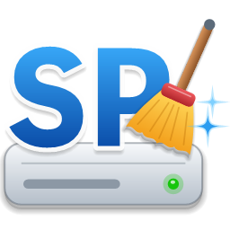

# SPCleaner+

Windows için tek exe'lik, kurulum gerektirmeyen geçici dosya temizleyici.
Açılır açılmaz temizliğe başlar, ilerlemeyi gösterir, kaç dosya silindiğini ve ne kadar yer açıldığını yazar,
birkaç saniye sonra kendiliğinden kapanır.



## Neleri temizler

| Hedef | Kural |
|---|---|
| `C:\Windows\Temp` | Hepsi (yönetici izni gerekir) |
| Kullanıcının Temp klasörü (`%TEMP%`, `%TMP%`, kayıt defterindeki TEMP/TMP) | Hepsi |
| Diğer kullanıcıların `AppData\Local\Temp` klasörleri | Hepsi (yönetici izni gerekir) |
| Windows hata raporları (WER: `ReportQueue`, `ReportArchive`, `Temp`) | Sadece **7 günden eski** olanlar |
| Çökme dökümleri (`C:\Windows\Minidump`, `C:\Windows\MEMORY.DMP`, `AppData\Local\CrashDumps`) | Sadece **7 günden eski** olanlar |
| Windows Update indirme önbelleği (`C:\Windows\SoftwareDistribution\Download`) | Sadece **7 günden eski** olanlar; Windows Update, BITS veya Windows Modules Installer çalışıyorsa ya da yeniden başlatma bekleniyorsa **hiç dokunulmaz** (yönetici izni gerekir) |
| Teslim İyileştirme önbelleği | Windows'un kendi `Delete-DeliveryOptimizationCache` komutuyla; aktif bir indirme varsa atlanır (yönetici izni gerekir) |

**Bilerek dokunulmayanlar:** Geri Dönüşüm Kutusu, tarayıcı önbellekleri, küçük resim/simge önbelleği,
Prefetch, WinSxS, Installer önbelleği.

## Güvenlik

- `C:\`, Windows, System32, SysWOW64, Program Files, ProgramData, Users ve kullanıcı profili klasörleri asla silinmez.
- Junction/symlink bağlantılarının içine girilmez; sadece bağlantının kendisi kaldırılır.
- Kullanımdaki (kilitli) dosyalar zorlanmaz; bir sonraki yeniden başlatmada silinmek üzere işaretlenir.
- Önce `/PREVIEW` ile hiçbir şey silmeden ne silineceği görülebilir.
- İş bitince bildirimdeki **Ayrıntılar** düğmesi her kaynaktan ne kadar silindiğini ve atlananların nedenini gösterir.

## Yönetici izni

Program normal kullanıcı olarak açılır ve kendini Windows'un standart UAC onayıyla yönetici olarak yeniden başlatır
(ikonda UAC kalkanı görünmez; UAC atlatılmaz). Onay verilmezse **sınırlı modda** çalışır: sadece kullanıcının kendi
klasörlerini temizler; bildirimde sarı **"Sınırlı mod"** rozeti görünür.

## Kullanım

Çift tıklamak yeterli. Komut satırı seçenekleri:

| Parametre | Anlamı |
|---|---|
| `/PREVIEW` | Hiçbir şey silmez, sadece ne silineceğini hesaplar |
| `/LOG` | Sonucu exe'nin yanına `SPCleaner+.log` olarak yazar |
| `/S` | Pencere göstermeden (sessiz) çalışır; zamanlanmış görev için |
| `/AGE:24` | Sadece 24 saatten eski dosyaları siler (sayı değiştirilebilir) |
| `/CURRENTUSER` | Sadece şu anki kullanıcının klasörleri |
| `/NOREBOOT` | Kilitli dosyaları yeniden başlatmaya bırakmaz |
| `/EXCLUDE:a;b` | Hariç tutulacak desenler (`*` ve `?` kullanılabilir) |

Örnek (silmeden dene ve log yaz):

```
"SPCleaner+.exe" /PREVIEW /LOG
```

**Çıkış kodları:** `0` başarılı · `1` hata oldu · `2` silinecek bir şey yoktu · `-1` zaten çalışıyor

## Gereksinimler

- Windows 10 / 11 (x64)
- .NET Framework 4.8 (Windows 10/11 ile hazır gelir)

## Derleme

Ek bir araç gerekmez; Windows'ta hazır gelen C# derleyicisi kullanılır.

```
build.bat
```

Çıktı: `SPCleaner+.exe`. Bütün kaynak kod tek dosyada: `SPCleaner+.cs`.

İkon (`SPCleaner+.ico`) kodla çizilir. Değiştirmek için `ikon/IkonOlustur.cs` düzenlenip
`ikon\ikon_olustur.bat`, ardından `build.bat` çalıştırılır.
